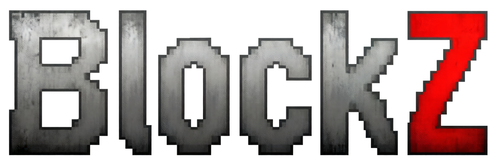

[简体中文](README.md) | [English](README_en_us.md)

BlockZ is a hardcore apocalyptic survival mod for Minecraft 1.20.1 (Forge), inspired by DayZ and DayM. Built around DayZ-style inventories, grid-based items, medical conditions, tactical stances and multiplayer synchronization, it slows the game down and makes every decision matter.

From grid backpacks and corpse looting to body temperature, thirst, disease, bleeding, fractures and weight, every trip outside is a risk assessment. See the Wiki for installation, configuration, commands and compatibility.

## Documentation & Community

* [Wiki](https://yitian77.github.io/)

[Join the BlockZ Discord community](https://discord.gg/3GktAbyfYt)

## Contributing

Issues and pull requests are welcome.

* Use Java 17 and Forge 1.20.1 official mappings, and follow the existing package and naming conventions.
* Use braces for `if` statements, UPPER_SNAKE_CASE for constants, and add `@Override` where appropriate.
* When changing configuration, update the Cloth Config screen and both `zh_cn.json` / `en_us.json`.
* When changing packet fields, update both client and server, and bump `NetworkHandler.PROTOCOL`.
* Keep classes focused; do not commit build artifacts, logs or temporary files.

## License

BlockZ is licensed under the **GNU General Public License v3.0**. See [LICENSE](LICENSE). You may use it in modpacks, videos and streams with attribution; modified or redistributed versions must remain under GPL-3.0.

## Credits

yitian77, GeckoLib, Minecraft Forge, Curios API, TACZ, Thirst Was Taken, Cloth Config, JEI, DayZ / DayM, and everyone who tested, reported issues or supported the project.

## Sponsor

[Support my work on Afdian](https://ifdian.net/a/yitianys)
